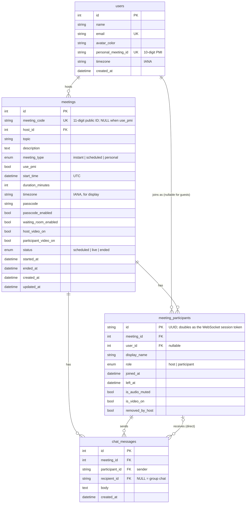

# Zoom Workplace Clone

A video-conferencing web app modelled on the Zoom Workplace web client. It covers the Home dashboard, instant and scheduled meetings, joining by Meeting ID or invite link, and a live meeting room with real peer-to-peer audio/video, chat, reactions, screen sharing and host controls.

| Layer    | Tech |
|----------|------|
| Frontend | Next.js 16 (App Router, client-rendered SPA), React 19, TypeScript, Tailwind CSS v4, lucide-react |
| Backend  | Python 3.12, FastAPI, SQLAlchemy 2, Pydantic 2, native WebSockets |
| Database | SQLite |
| Realtime | WebRTC full mesh for media; FastAPI WebSocket for signalling and room events |

---

## Features

**Core**
- **Home dashboard:** live clock, the New meeting / Join / Schedule tiles, a calendar day view with a date-picker popover and Today/‹/› navigation, a meeting details slide-over, and **Recent meetings**.
- **Instant meeting:** creates a unique 11-digit Meeting ID and a passcode-protected invite link, then drops the host straight into the room. The chevron menu offers *Start with video* and *Use my PMI*.
- **Join meeting:** the Join dialog accepts a Meeting ID (spaces allowed) or a full invite link, and validates that the meeting exists before routing to Zoom's full-screen **Enter Meeting Info** join screen. It has a camera preview with Mute / Stop Video (blocked-device warnings included), your name with "Remember my name for future meetings", and a passcode field that appears only when the link didn't carry one.
- **Schedule meeting:** topic, description, date picker, time + AM/PM, duration, time zone, auto-generated ID or PMI, passcode, waiting room and host/participant video. Scheduled meetings are stored in SQLite and appear in the Home calendar and in Meetings → Upcoming.
- **Meetings tab:** Upcoming/Recent list with a detail pane: Start, Copy Invitation, Edit and Delete, plus a Show/Hide invitation toggle. Edit reuses the Schedule form.

**Meeting room**
- Real audio/video between browsers (WebRTC mesh).
- **Speaker view** by default: one person on the stage and a thumbnail strip on top, like Zoom. The header grid icon switches to **Gallery view**.
- Participants get a full-screen meeting without the Workplace navbar or side rail; the host's meeting runs inside Workplace.
- Account users show an avatar when video is off; guests show their name, as Zoom does for people without a profile picture. Name tags show mute state.
- Mic/camera toggles, including the permission-denied banner and blocked-device icons from the designs, plus screen sharing.
- Participants panel, emoji reactions and a meeting-info popover with a copy-link action.
- Meeting chat, persisted: *Meeting Group Chat* plus **direct messages**. Direct messages are delivered, and replayed in chat history, only to the sender and recipient.
- Controls auto-hide after 3 s of inactivity, as in the Zoom web client.
- Reconnects automatically after a network blip or page refresh.
- **Minimized meeting:** leaving the meeting page (e.g. clicking Home) shrinks the call to a mini window in the bottom-right corner. The call keeps running; the mini window has mic, video, leave and back-to-meeting controls. Home then shows **Back to Meeting** instead of New meeting, and **Join** is greyed out. The meeting is rendered once by a `MeetingDock` in the root layout, driven by a small active-meeting store (`lib/activeMeeting.ts`), so navigation never tears down the WebSocket or WebRTC connections.

**Bonus**
- **Host controls:** a Zoom-style **Host tools** panel, all enforced server-side.
  - **Enable waiting room:** guests wait in a lobby until the host admits or removes them. It defaults to the meeting's scheduled Waiting Room option.
  - **Lock Meeting:** new joins are rejected.
  - **Hide profile pictures:** tiles show names instead of avatars.
  - **Participants →** *Suspend Participant Activities*, plus *Allow participants to:* Chat, Rename Themselves, Unmute Themselves and Start Video.
  - **Share →** also opened from the Share button's **^ → Host tools for share**:
    - *How many participants can share at the same time?* One at a time, or multiple simultaneously.
    - *Who can share?* All Participants or Only Host.
    - *Who can start sharing when someone else is sharing?* All Participants or Only Host. When allowed, starting a share takes over the current one.
    - In multiple mode the two "who" settings are fixed to All Participants, as in Zoom.
  - **Advanced →** Mute all.
  - The host can also mute, rename or remove individual participants, and end the meeting for everyone.
- **Responsive:** a bottom tab bar on phones; stacked list/detail on the Meetings tab; form labels above inputs; a single-column video grid; secondary room controls folded into *More*.

---

## Getting started

Prerequisites: Python 3.12+ and Node.js 20+.

### 1. Backend (http://localhost:8000)

```bash
cd backend
python3 -m venv .venv && source .venv/bin/activate
pip install -r requirements.txt
cp .env.example .env
python -m app.seed            # optional: the API also seeds an empty DB on startup
uvicorn app.main:app --reload --port 8000
```

Interactive API docs are at http://localhost:8000/docs. Reset the sample data with `python -m app.seed --reset`.

### 2. Frontend (http://localhost:3000)

```bash
cd frontend
cp .env.example .env.local
npm install
npm run dev
```

### 3. Try a two-person call
1. Home → **New meeting**. You join as host.
2. Open the ⓘ icon in the meeting's top bar → **Copy link**.
3. Paste the link into a second browser, or an incognito window, and join as a guest.

Browsers only allow camera and microphone access on `https://` or `localhost`.

### Tests

```bash
cd backend && pytest       # 30 tests: services, REST API, realtime and Host tools
cd frontend && npm run lint && npx tsc --noEmit
```

---

## Environment variables

| Variable | Where | Default | Purpose |
|---|---|---|---|
| `DATABASE_URL` | backend | `sqlite:///./zoom_clone.db` | SQLAlchemy URL |
| `FRONTEND_URL` | backend | `http://localhost:3000` | Base URL used in invite links |
| `CORS_ORIGINS` | backend | `http://localhost:3000` | Comma-separated allowed origins |
| `SEED_ON_STARTUP` | backend | `true` | Seed sample data when the DB is empty |
| `EMPTY_ROOM_GRACE_SECONDS` | backend | `30` | How long an empty live meeting waits before it ends |
| `NEXT_PUBLIC_API_URL` | frontend | `http://localhost:8000` | Backend base URL |
| `NEXT_PUBLIC_WS_URL` | frontend | derived from the API URL (`http→ws`) | WebSocket base URL |
| `NEXT_PUBLIC_TURN_URL` / `_USERNAME` / `_CREDENTIAL` | frontend | — | Optional TURN server for strict NATs |

---

## Project structure

```
backend/app/
  main.py             FastAPI app, CORS, error mapping, startup (create tables + seed)
  config.py, db.py    settings; engine/session/Base (SQLite foreign keys enabled)
  deps.py             get_current_user: the "signed-in" default user (auth seam)
  models/             User, Meeting, MeetingParticipant, ChatMessage, enums
  schemas/            Pydantic request/response models + serializers
  services/           business rules: meeting_service, participant_service,
                      id_generator, invitation, timezones, domain errors
  routers/            users.py, meetings.py (REST), ws.py (WebSocket)
  realtime/           room_manager.py (in-memory rooms), handlers.py (message dispatch)
  seed.py             sample data
backend/tests/        pytest suite

frontend/src/
  app/(app)/          routes: home, meetings, meetings/schedule, meetings/[id]/edit,
                      j/[code] (pre-join), wc/[code] (meeting room), chat/contacts/settings
  components/shell/   TopBar, SideRail/BottomNav, AppShell, CurrentUser context
  components/home/    Clock, ActionTiles, CalendarCard, MeetingDetailsPanel, RecentMeetings
  components/meetings JoinMeetingModal, MeetingForm (+ form state), MeetingList,
                      MeetingDetailPane, PreJoin
  components/room/    MeetingRoom (orchestrator), VideoGrid/VideoTile, ControlBar,
                      RoomHeader, ParticipantsPanel, ChatPanel, reactions, banners
  components/ui/      Button, Modal, ConfirmDialog, Toast, form controls, Avatar
  hooks/              useLocalMedia, useMeetingSocket, useWebRTCMesh, useAsync,
                      useStartMeeting, useIdle, useNow, useLatest, useClickOutside
  lib/                api client, time-zone math, invite-link parsing, session storage
  types/api.ts        API + realtime message types (mirrors the backend schemas)
```

---

## Database design



**Design notes**
- **All timestamps are stored in UTC.** The meeting keeps the host's IANA `timezone` only for display and the invitation text ("Sep 30, 2026 08:30 PM India"). The browser does the wall-clock ↔ UTC conversion with `Intl`, with no date library.
- **Personal Meeting ID.** Each user has one persistent *personal room* (`meeting_type = personal`, `meeting_code = PMI`). A scheduled meeting that uses the PMI stores `meeting_code = NULL` and `use_pmi = true`; its join code resolves to the host's PMI. This keeps `meeting_code` UNIQUE even though many scheduled meetings can share one PMI. SQLite allows multiple NULLs under a UNIQUE index.
- **`meeting_participants` stores one row per join session,** not per person. It is the attendance history (who joined and left, and when; who was removed), and its UUID is the bearer token for the WebSocket. That way a guest never needs an account, and a removed participant cannot reconnect.
- **Recent meetings** are meetings that actually started (`started_at IS NOT NULL`), ordered by `started_at`. **Upcoming** meetings are scheduled meetings that haven't ended and whose time slot isn't over yet.
- Indexes: unique `meeting_code`, unique `personal_meeting_id`, `(host_id, start_time)` for calendar/range queries, and `status`. Foreign keys use `ON DELETE CASCADE` so deleting a meeting removes its participants and chat. `PRAGMA foreign_keys=ON` is set on every SQLite connection.
- Enums are stored as constrained strings (`native_enum=False`), which is portable to Postgres.
- `chat_messages.recipient_id` (nullable FK) marks direct messages; NULL means the group chat. Columns added after the first release are applied to existing SQLite files by a small additive migration on startup (`db.migrate_schema`).

---

## API

REST, prefix `/api`:

| Method | Path | Description |
|---|---|---|
| GET | `/me` | Default signed-in user |
| GET | `/timezones` | Time-zone options, e.g. `(GMT+5:30) India` |
| GET | `/meetings?from=&to=` | Scheduled meetings starting in a UTC range (calendar day view) |
| GET | `/meetings/upcoming` | Upcoming scheduled meetings |
| GET | `/meetings/recent` | Meetings that were held, most recent first |
| POST | `/meetings/instant` | Create an instant meeting `{use_pmi, video_on}` |
| POST | `/meetings` | Schedule a meeting |
| GET / PUT / DELETE | `/meetings/{id}` | Read / edit / delete (host only for writes) |
| POST | `/meetings/{id}/end` | End for everyone (host only) |
| GET | `/meetings/{id}/participants` | Everyone who joined (one entry per person, host first) with an "in meeting" flag |
| GET | `/meetings/code/{code}` | Validate a Meeting ID before joining: 404 unknown, 410 ended |
| POST | `/meetings/code/{code}/join` | `{display_name, passcode, as_host, audio_muted, video_on}` returns a participant session |

WebSocket `/ws/meetings/{meeting_id}?pid={participant_id}`:

| Direction | Messages |
|---|---|
| client → server | `signal {to, data}` · `media-state` · `chat` · `reaction` · `rename` · host only: `mute`, `mute-all`, `remove`, `admit`, `admit-all`, `deny`, `update-settings`, `suspend`, `end-meeting` |
| server → client | `waiting` · `room-state` (on entering) · `room-settings` · `waiting-list` (hosts) · `peer-joined` · `peer-updated` · `peer-left` · `signal` · `chat` · `reaction` · `force-mute` · `force-video-off` · `force-share-off` · `removed` · `meeting-ended` · `error` |

Host tools state (`RoomSettings`: waiting_room, locked, hide_profile_pictures, allow_chat / rename / unmute / video / share, share_mode, share_takeover) lives with the live room in memory and resets each session, as in Zoom.

---

## Key implementation decisions

- **WebRTC full mesh.** Every participant holds one `RTCPeerConnection` per other participant. There's no media server, which makes it simple and free, and it's ideal for small meetings of about 2–6 people. Larger meetings would need an SFU such as LiveKit or mediasoup.
- **No offer glare.** Only the newcomer sends offers (to everyone listed in `room-state`); existing members only answer.
- **No renegotiation.** Each connection gets one audio and one video transceiver up front. Mute (`track.enabled`), camera on/off and screen share all go through `RTCRtpSender.replaceTrack`. Turning video off stops the camera track, so the camera light goes off.
- **Server-side authority.** Host tools are checked against the participant's role on the server, not just hidden in the UI. Passcodes are validated on join.
- **Resilience.** A dropped socket reconnects with the same participant session. A live meeting ends only after it has been empty for `EMPTY_ROOM_GRACE_SECONDS`, so a refresh doesn't kill it.
- **Thin routers.** Business rules live in `services/` and raise domain errors that one exception handler maps to HTTP codes. This keeps the logic unit-testable without HTTP.

---

## Assumptions and limitations

- **No login.** The first seeded user ("Jerry NotAbout") is treated as signed in via `get_current_user`. Any browser pressing **Start** on a meeting joins as its host; people who join through the Join dialog or an invite link join as participants. Swapping that one dependency for real auth is the only backend change needed.
- **The Edit form deliberately mirrors the Schedule form.** Recurring meetings, invitees, whiteboards, docs and encryption options from Zoom's full edit page are out of scope.
- **Host tools permissions are enforced at the signalling layer.** The server rejects disallowed actions, and every client renders the server's view of each participant, e.g. a blocked camera shows as an avatar. Media is peer-to-peer, though, so a deliberately modified client could still send raw frames; true media enforcement needs an SFU.
- **Scheduled PMI meetings** start in the host's personal room, so the scheduled row itself isn't marked live.
- **Realtime state is in-memory** in a single backend process, which fits SQLite. Horizontal scaling would need Redis pub/sub for room fan-out.
- **NAT traversal** uses public STUN only. Some corporate or mobile networks will need a TURN server (see the env vars).
- Chat, Contacts and Settings in the side rail are placeholders, as are search, notifications and calendar connection.
- The sample-data user name and IDs match the provided design screenshots.

---

## Deployment notes

The app is platform-agnostic; everything is configured through environment variables.

- **Frontend** (e.g. Vercel): set `NEXT_PUBLIC_API_URL` (and optionally `NEXT_PUBLIC_WS_URL`) to the public backend URL.
- **Backend** (e.g. Render or Railway): run `uvicorn app.main:app --host 0.0.0.0 --port $PORT` with **one worker**. Mount a persistent disk and point `DATABASE_URL` at it, e.g. `sqlite:////data/zoom_clone.db`. Set `FRONTEND_URL` and `CORS_ORIGINS` to the frontend URL. The host must support WebSockets.
- Serve both over **HTTPS**, since browsers block camera and mic access on insecure origins, and `wss://` is required from an https page.
